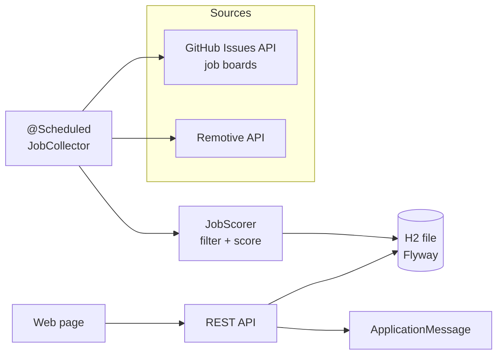

# Radar de Vagas

[](https://github.com/Lucas-blip-png/radar-vagas/actions/workflows/ci.yml)

A personal job radar and application tracker: it collects openings from public job APIs, keeps only the ones that fit a junior Java/back-end profile (remote, or on-site in Campo Grande/MS), scores them, and tracks each application from "new" to "offer" with follow-up reminders.

Built with Java 21 and Spring Boot 4.

## Features

- **Collection** from public sources, on a schedule (every 6h) or on demand
  - GitHub issues of Brazilian community job boards ([backend-br/vagas](https://github.com/backend-br/vagas) by default, more boards via config)
  - [Remotive](https://remotive.com) remote jobs API
- **Filtering and scoring**: rejects senior/lead roles, non back-end roles and remote jobs restricted to other countries; ranks by Java/Spring, junior level, location and stack
- **Deduplication** by URL, so each opening shows up once
- **Application tracking**: `NOVA → APLICADA → ENTREVISTA → OFERTA / RECUSADA`, with a follow-up date set automatically when you apply
- **Application message**: one click copies a message tailored to the opening, built from the profile in `application.yml`
- **Saved searches** for sites without a public API (LinkedIn, Gupy, Indeed)

## Architecture



## Why it doesn't auto-apply

Automating logins and applications on LinkedIn and most job sites breaks their terms of service and can get the account restricted. The radar does everything up to the last step: it finds, filters and ranks openings, prepares the message and opens the original post. Sending the application is one click by a person.

It also follows each source's rules: Remotive and the job boards are linked back to the original post and not republished anywhere.

## Running

Requires Java 21.

```bash
./mvnw spring-boot:run
# open http://localhost:8080 and click "Buscar vagas agora"
```

On Windows, `radar.ps1` builds the app on first use, starts it in the background, runs a collection and opens the page:

```powershell
.\radar.ps1
```

With Docker:

```bash
docker compose up --build
```

Optional: set `GITHUB_TOKEN` to raise the GitHub API limit from 60 to 5000 requests per hour.

## Configuration

Everything lives in `src/main/resources/application.yml` under `radar:`:

| Key | Default | Meaning |
| --- | --- | --- |
| `github-repos` | `backend-br/vagas` | Comma-separated GitHub repos whose issues are job posts |
| `remotive-search` | `java` | Search term for Remotive |
| `collect-interval` | `6h` | How often to collect |
| `min-score` | `30` | Openings below this score are ignored |
| `follow-up-days` | `7` | Days after applying until the follow-up reminder |
| `profile.*` | | Name, links, pitch and projects used in the application message |

## REST API

| Method | Path | Description |
| --- | --- | --- |
| `GET` | `/api/jobs?status=` | Jobs by status (default: all but discarded), best score first |
| `PATCH` | `/api/jobs/{id}` | `{"status": "APLICADA", "notes": "..."}` |
| `GET` | `/api/jobs/{id}/message` | Application message (text) |
| `POST` | `/api/collect` | Collect now; returns how many were read, saved and which sources failed |

## Tests

```bash
./mvnw verify
```

- `JobScorerTest`: level, stack, location and country-restriction rules, whole-word matching
- `JobSourcesTest`: both API clients against recorded JSON responses (`MockRestServiceServer`), so CI never depends on the network
- `JobCollectorTest`: deduplication across runs, minimum score, one failing source not stopping the others
- `JobControllerTest`: status changes, follow-up scheduling, message generation, validation and 404s

## Roadmap

- More sources as they become available with public APIs (Jobicy was evaluated; its Brazil/LATAM openings are currently senior only)
- E-mail digest of new openings

## License

[MIT](LICENSE) © 2026 Lucas Daniel Duarte Cabral
